# Typography audit

_Generated 2026-11-10 from the local site (localhost:3000), commit f68408e plus uncommitted changes._

Every place a line of text breaks badly or the copy slips, page by page, at **desktop (1440px)** and **phone (375px)** widths. Each high- and medium-severity incident has a screenshot of exactly where it is; low-severity ones are listed in a table under each page (they're mostly small words at line ends, and there are many).

## How to read this

- **#number**: the incident's id. The same number is drawn on its screenshot (red tag).
- **Red solid box**: the exact line, word or characters with the problem. **Dashed red box**: the paragraph or block it belongs to.
- **Where**: the page and section (the case-study rail label where there is one), with a link you can open on the local site.
- **Severity**: **High**, clearly broken (punctuation starting a line, a lone word under a heading); **Medium**, noticeable (a lone word ending a paragraph, copy errors); **Low**, cosmetic (a short word like "the" at a line end, a ragged line).
- Screenshots are taken in dark mode, from a scroll through the page, so pinned slides and reveals are included. The two password-gated case studies were unlocked locally.

## At a glance

Counts are **High / Medium / Low**.

| Page | Desktop 1440px | Phone 375px |
|---|---|---|
| Home | 0 / 0 / 0 | 0 / 0 / 1 |
| Work | 0 / 0 / 4 | 0 / 0 / 5 |
| About | 0 / 3 / 3 | 0 / 2 / 7 |
| Play | 0 / 0 / 1 | 1 / 0 / 2 |
| Résumé | 0 / 0 / 12 | 0 / 0 / 20 |
| Draft (BimaKavach case study) | 0 / 2 / 11 | 2 / 9 / 27 |
| Peetal | 1 / 0 / 22 | 1 / 1 / 24 |
| Logo lab | 0 / 0 / 1 | 0 / 0 / 0 |
| Bima Saathi (gated) | 0 / 1 / 3 | 0 / 1 / 10 |
| BimaKavach Identity (gated) | 1 / 7 / 12 | 0 / 5 / 10 |
| **Total** | **2 / 13 / 69** | **4 / 18 / 106** |

## What causes most of it

Most incidents come from a handful of site-wide causes; fixing these clears whole groups at once.

| | Cause | What it does | Fix |
|---|---|---|---|
| A | Link chips are inline boxes, and browsers allow a break right after a box | Punctuation can start a line | Keep a chip and its punctuation together. **Fixed on home** (see below). |
| B | `text-wrap: balance` is set on every paragraph and list item, but Chrome only balances blocks of up to 6 lines | Longer paragraphs fall back to plain wrapping: lone last words, short last lines | Use `pretty` for paragraphs and list items; keep `balance` for headings, short blurbs, labels and buttons |
| C | Display sizes on phones (36px section titles, 28px card titles) in a ~327px column | 2–4 word headings leave one word on a line | Step titles down below 640px, or keep the last two words together |
| D | Narrow two-column stat and team grids on phones | 3–4 word labels and "Name (Role)" break with a lone word | Balance the labels; keep a role and its brackets on one line |
| E | Nothing stops short words ending a line | Many lines end on "a", "the", "of", "and" | A small helper that joins short words to the next with a non-breaking space, in headings and short copy |

## Already fixed

- **Home hero: comma at the start of a line.** The comma after "145 East" dropped to the next line. Each company chip now stays on one line with its comma.
- **Home hero: company chips off the baseline.** Chip names sat 1–2px off the sentence and logos at uneven heights. Chips are now inline text on the sentence's baseline, logos centred on the cap height.
- **Draft 002 timeline: "Companies." alone on the last line (#139, phone).** Fixed after this run: each paragraph in the timeline now keeps its last two words together.

## Issue types

| Issue | What it looks like | Why it matters | Usual fix |
|---|---|---|---|
| Widow: one word alone on the last line | A paragraph or label ends with a single word on its own line. | Leaves a stub that looks unfinished and wastes a line. | Use `text-wrap: pretty` on long paragraphs (B); keep the last two words together in short labels (D). |
| Heading: one word alone on the last line | A heading or large figure breaks with one word on its last line. | At display sizes a lone word is very visible and splits the phrase. | Smaller heading size on phones, or keep the last two words together (C). |
| Heading: one word alone on the first line | A heading's first line holds a single word, the rest below. | Unbalanced shape; the first word reads as a label. | Keep the trailing words together, or size the heading so it fits (C). |
| Very short last line | The last line is under a fifth of the longest line. | A weak, ragged ending to the block. | `text-wrap: pretty` (B). |
| Short word stranded at a line end | A line ends on a small word (a, the, of, and, to…) that belongs with the next line. | Breaks a phrase at its weakest point; cosmetic, but it adds up. | Join short words to the next word with a non-breaking space in headings and short copy (E). |
| Deep rag: a middle line far shorter | One middle line is much shorter than its neighbours. | Leaves a hole in the paragraph's right edge. | `text-wrap: pretty` (B), or a small copy edit. |
| Hyphenated word wraps at its hyphen | A hyphenated compound (user-centered) splits at its own hyphen. | Acceptable in body text; only fix where it reads badly. | Optional: a non-breaking hyphen (U+2011) in short compounds. |
| Copy: em/en dash in visible text | An em (—) or en (–) dash in visible copy. | The site's rule is a spaced hyphen ( - ). | Replace with " - ". |
| Copy: hyphen used as a dash, unspaced | A hyphen used as a dash with a space on one side only ("Rishabh- a"). | Looks like a typo; breaks the site's spaced-hyphen rule. | Space both sides: " - ". |
| Copy: three dots instead of an ellipsis (…) | Three full stops used as an ellipsis. | Spacing is loose; the real character (…) is tighter. | Use … |
| Copy: straight apostrophe (use ’) | A straight ' where a curly ’ belongs. | Inconsistent: About and Résumé already use curly ones. | Use ’. |

## Incidents by page

### Home

`/`

No high or medium incidents.

Low severity on this page (1), no screenshots

| # | Width | Where | Issue | Line as it breaks |
|---|---|---|---|---|
| 85 | Phone | main | Short word stranded at a line end | `Practicing Experience Design at` |

### Work

`/work`

No high or medium incidents.

Low severity on this page (9), no screenshots

| # | Width | Where | Issue | Line as it breaks |
|---|---|---|---|---|
| 1 | Desktop | main | Copy: straight apostrophe (use ’) | `BimaKavach's` |
| 2 | Desktop | main | Short word stranded at a line end | `ng the product that turned 1,000 agents into` |
| 3 | Desktop | main | Copy: straight apostrophe (use ’) | `India's` |
| 4 | Desktop | main | Copy: straight apostrophe (use ’) | `India's` |
| 86 | Phone | main | Copy: straight apostrophe (use ’) | `BimaKavach's` |
| 87 | Phone | main | Short word stranded at a line end | `ng the product that turned 1,000 agents into` |
| 88 | Phone | main | Copy: straight apostrophe (use ’) | `India's` |
| 89 | Phone | main | Short word stranded at a line end | `ny that is rooted in India's rich history of` |
| 90 | Phone | main | Copy: straight apostrophe (use ’) | `India's` |

### About

`/about`

#### #5 · Copy: hyphen used as a dash, unspaced · Desktop 1440px · Medium

- **Where:** main ([open](http://localhost:3000/about))
- **The problem line / text:** `Rishabh- a`
- **In the block:** "Hello World, I’m Rishabh- a Visual Designer based out of Bengaluru, India. As a thespian and film student who’s started his career in video editing and creative direction, I have s…"
- **Fix:** Space both sides: " - ".

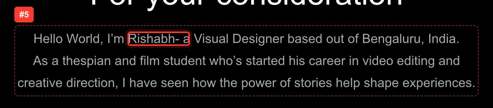

#### #9 · Copy: hyphen used as a dash, unspaced · Desktop 1440px · Medium

- **Where:** main ([open](http://localhost:3000/about))
- **The problem line / text:** `Rishabh- a`
- **In the block:** "Hello World, I’m Rishabh- a Visual Designer based out of Bengaluru, India. As a thespian and film student who’s started his career in video editing and creative direction, I have s…"
- **Fix:** “Rishabh - a Visual Designer” (the site's spaced hyphen)

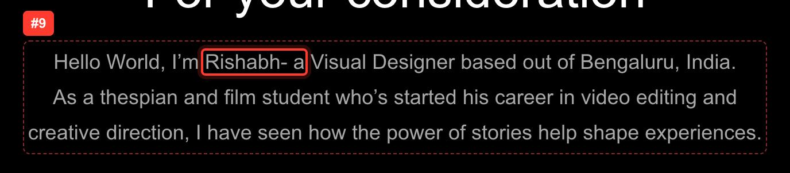

#### #10 · Copy: typo · Desktop 1440px · Medium

- **Where:** main ([open](http://localhost:3000/about))
- **The problem line / text:** `weather good or bad`
- **In the block:** "My experiences, weather good or bad, have shaped who I am today. The duality of privilege and burden, of wealth and poverty, and of peace and chaos, are all potent in forming my ea…"
- **Fix:** “whether good or bad”

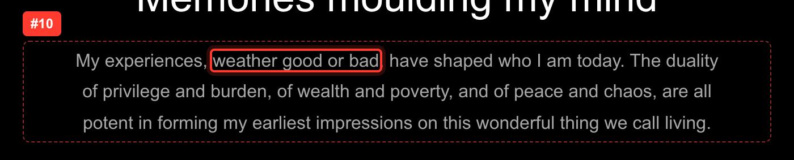

#### #91 · Copy: hyphen used as a dash, unspaced · Phone 375px · Medium

- **Where:** main ([open](http://localhost:3000/about))
- **The problem line / text:** `Rishabh- a`
- **In the block:** "Hello World, I’m Rishabh- a Visual Designer based out of Bengaluru, India. As a thespian and film student who’s started his career in video editing and creative direction, I have s…"
- **Fix:** Space both sides: " - ".

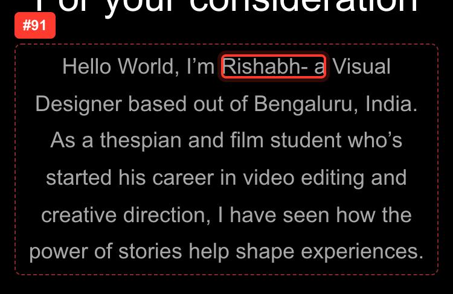

#### #99 · Widow: one word alone on the last line · Phone 375px · Medium

- **Where:** main ([open](http://localhost:3000/about))
- **The problem line / text:** `diamonds.`
- **In the block:** "My childhood was filled with awe. I remember distinctly sitting on the floor as a toddler, looking awestruck at the window in front of me. It’s a sunny afternoon in the hot, hot ci…"
- **Fix:** Use `text-wrap: pretty` on long paragraphs (B); keep the last two words together in short labels (D).

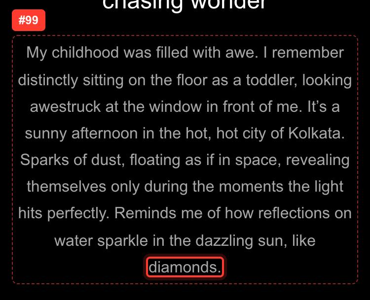

Low severity on this page (10), no screenshots

| # | Width | Where | Issue | Line as it breaks |
|---|---|---|---|---|
| 6 | Desktop | main | Short word stranded at a line end | `ho’s started his career in video editing and` |
| 7 | Desktop | main | Short word stranded at a line end | `hat it has to offer. I could float, fly, and` |
| 8 | Desktop | main | Short word stranded at a line end | `eing able to be creative and expressive in a` |
| 92 | Phone | main | Short word stranded at a line end | `started his career in video editing and` |
| 93 | Phone | main | Short word stranded at a line end | `creative direction, I have seen how the` |
| 94 | Phone | main | Short word stranded at a line end | `of privilege and burden, of wealth and` |
| 95 | Phone | main | Short word stranded at a line end | `as to offer. I could float, fly, and soar. I` |
| 96 | Phone | main | Short word stranded at a line end | ` flight to India’s Silicon Valley - I knew I` |
| 97 | Phone | main | Short word stranded at a line end | `estruck at the window in front of me. It’s a` |
| 98 | Phone | main | Short word stranded at a line end | ` perfectly. Reminds me of how reflections on` |

### Play

`/play`

#### #102 · Heading: one word alone on the last line · Phone 375px · High

- **Where:** #play ([open](http://localhost:3000/play#play))
- **The problem line / text:** `sequence`
- **In the block:** "mr. ray's sequence"
- **Fix:** Smaller heading size on phones, or keep the last two words together (C).

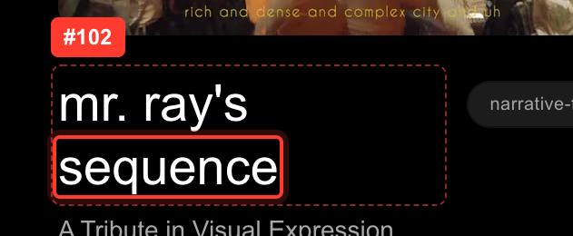

Low severity on this page (3), no screenshots

| # | Width | Where | Issue | Line as it breaks |
|---|---|---|---|---|
| 11 | Desktop | #play | Copy: straight apostrophe (use ’) | `ray's` |
| 100 | Phone | #play | Short word stranded at a line end | `A Quick Tool made to create the` |
| 101 | Phone | #play | Copy: straight apostrophe (use ’) | `ray's` |

### Résumé

`/resume`

No high or medium incidents.

Low severity on this page (32), no screenshots

| # | Width | Where | Issue | Line as it breaks |
|---|---|---|---|---|
| 12 | Desktop | #about | Short word stranded at a line end | `digital products. Currently, I am working on` |
| 13 | Desktop | #about | Short word stranded at a line end | `taking shape at 145 East, where I focused on` |
| 14 | Desktop | #about | Hyphenated word wraps at its hyphen | `user-centered,` |
| 15 | Desktop | #about | Very short last line | `and action.` |
| 16 | Desktop | #about | Short word stranded at a line end | ` core of a business, product and service and` |
| 17 | Desktop | #about | Short word stranded at a line end | ` and a passion for re-inventing the wheel, I` |
| 18 | Desktop | #experience | Hyphenated word wraps at its hyphen | `self-serve` |
| 19 | Desktop | #experience | Short word stranded at a line end | ` merchandise, HR/admin), led end-to-end from` |
| 20 | Desktop | #experience | Short word stranded at a line end | `A conversion on the Quote Generation page by` |
| 21 | Desktop | #experience | Short word stranded at a line end | `on that cut design-to-dev handoff time by an` |
| 22 | Desktop | #experience | Short word stranded at a line end | `sign shipped end-to-end, from wireframes and` |
| 23 | Desktop | #experience | Short word stranded at a line end | `rected India’s first VEVO music video out of` |
| 103 | Phone | #about | Short word stranded at a line end | ` Product and Visual Designer with 5 years of` |
| 104 | Phone | #about | Short word stranded at a line end | `ey started taking shape at 145 East, where I` |
| 105 | Phone | #about | Short word stranded at a line end | `Design and Graphic Design. Joining Nymbl and` |
| 106 | Phone | #about | Short word stranded at a line end | `Vedantu, have shaped my skills especially in` |
| 107 | Phone | #about | Short word stranded at a line end | `ollaborating with exceptional Individuals in` |
| 108 | Phone | #about | Short word stranded at a line end | `ors, I create user-centered, functional, and` |
| 109 | Phone | #about | Short word stranded at a line end | `. I love coming up with ideas that come from` |
| 110 | Phone | #about | Short word stranded at a line end | `hinking due to my past in film, theatre, and` |
| 111 | Phone | #about | Short word stranded at a line end | ` art. With obsessive attention to detail and` |
| 112 | Phone | #experience | Short word stranded at a line end | `1,000 agents onboarded onto Bima Saathi, a` |
| 113 | Phone | #experience | Short word stranded at a line end | `led end-to-end from user research and` |
| 114 | Phone | #experience | Short word stranded at a line end | `Devanagari and Dravidian scripts, and` |
| 115 | Phone | #experience | Short word stranded at a line end | `embedding typographic foundations into` |
| 116 | Phone | #experience | Short word stranded at a line end | `by leading the platform migration from` |
| 117 | Phone | #experience | Hyphenated word wraps at its hyphen | `design-to-dev` |
| 118 | Phone | #experience | Short word stranded at a line end | `handoff time by an estimated 40% and` |
| 119 | Phone | #experience | Short word stranded at a line end | `ep flow simplified to 4 for the purchase and` |
| 120 | Phone | #experience | Short word stranded at a line end | `developer handoff and QA, resulting in` |
| 121 | Phone | #experience | Short word stranded at a line end | `Performance marketing creatives designed for` |
| 122 | Phone | #experience | Short word stranded at a line end | `Conversion-focused campaigns for` |

### Draft (BimaKavach case study)

`/draft`

#### #35 · Copy: grammar · Desktop 1440px · Medium

- **Where:** 006. Flows - Checkout & Payment ([open](http://localhost:3000/draft#flows))
- **The problem line / text:** `page exists and`
- **In the block:** "Massive diversions and permutations from the quote page exists and change per product - meaning that the journey must seem consistent and concise for any user"
- **Fix:** “permutations … exist”

#### #36 · Copy: missing hyphen · Desktop 1440px · Medium

- **Where:** main ([open](http://localhost:3000/draft))
- **The problem line / text:** `asking no brainer`
- **In the block:** "By showcasing a loading state of the Quote Page and asking no brainer questions in the form of a modal - we were able to reduce drop-offs, as the user is now more incentivized to c…"
- **Fix:** “no-brainer”

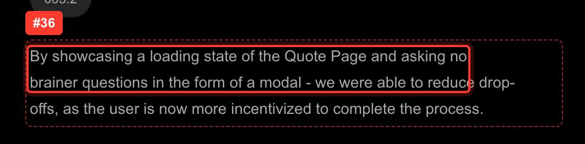

#### #143 · Heading: one word alone on the last line · Phone 375px · High

- **Where:** 004. Solutions - Typography ([open](http://localhost:3000/draft#typography))
- **The problem line / text:** `Typography`
- **In the block:** "Solutions - Typography"
- **Fix:** Smaller heading size on phones, or keep the last two words together (C).

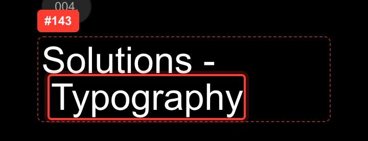

#### #148 · Heading: one word alone on the last line · Phone 375px · High

- **Where:** 005. Solutions - Forms & Modals for Discovery & Quote Generation ([open](http://localhost:3000/draft#forms))
- **The problem line / text:** `Generation`
- **In the block:** "Solutions - Forms & Modals for Discovery & Quote Generation"
- **Fix:** Smaller heading size on phones, or keep the last two words together (C).

#### #126 · Widow: one word alone on the last line · Phone 375px · Medium

- **Where:** 001. How did my story start? ([open](http://localhost:3000/draft#story))
- **The problem line / text:** `Checkouts`
- **In the block:** "Increase in Online Checkouts"
- **Fix:** Use `text-wrap: pretty` on long paragraphs (B); keep the last two words together in short labels (D).

#### #127 · Widow: one word alone on the last line · Phone 375px · Medium

- **Where:** 001. How did my story start? ([open](http://localhost:3000/draft#story))
- **The problem line / text:** `& CEO)`
- **In the block:** "Tejas Jain (Founder & CEO)"
- **Fix:** Use `text-wrap: pretty` on long paragraphs (B); keep the last two words together in short labels (D).

#### #128 · Widow: one word alone on the last line · Phone 375px · Medium

- **Where:** 001. How did my story start? ([open](http://localhost:3000/draft#story))
- **The problem line / text:** `Experience)`
- **In the block:** "Gopi Solia (Brand & Experience)"
- **Fix:** Use `text-wrap: pretty` on long paragraphs (B); keep the last two words together in short labels (D).

#### #130 · Widow: one word alone on the last line · Phone 375px · Medium

- **Where:** 001. How did my story start? ([open](http://localhost:3000/draft#story))
- **The problem line / text:** `(Engineering)`
- **In the block:** "Vishnu Gupta (Engineering)"
- **Fix:** Use `text-wrap: pretty` on long paragraphs (B); keep the last two words together in short labels (D).

#### #131 · Widow: one word alone on the last line · Phone 375px · Medium

- **Where:** 001. How did my story start? ([open](http://localhost:3000/draft#story))
- **The problem line / text:** `(Engineering)`
- **In the block:** "Rohit Mishra (Engineering)"
- **Fix:** Use `text-wrap: pretty` on long paragraphs (B); keep the last two words together in short labels (D).

#### #137 · Heading: one word alone on the first line · Phone 375px · Medium

- **Where:** 002. The Pivot and the Problem ([open](http://localhost:3000/draft#problem))
- **The problem line / text:** `Minimum`
- **In the block:** "Minimum Viable Product"
- **Fix:** Keep the trailing words together, or size the heading so it fits (C).

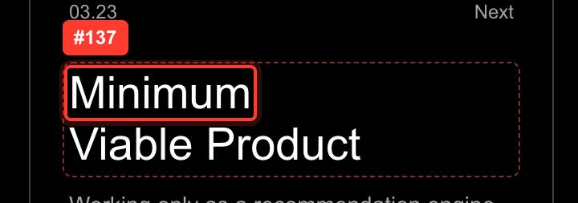

#### #139 · Widow: one word alone on the last line · Phone 375px · Medium

- **Where:** 002. The Pivot and the Problem ([open](http://localhost:3000/draft#problem))
- **The problem line / text:** `Companies.`
- **In the block:** "Initial attempts to create quote generation resulted in a successful IRDAI License. We realized that the basic Product Landing Page (PLP) would require lead generation, Raters and …"
- **Fix:** Use `text-wrap: pretty` on long paragraphs (B); keep the last two words together in short labels (D).

#### #140 · Widow: one word alone on the last line · Phone 375px · Medium

- **Where:** 002. The Pivot and the Problem ([open](http://localhost:3000/draft#problem))
- **The problem line / text:** `Checkout`
- **In the block:** "Products at Online Checkout"
- **Fix:** Use `text-wrap: pretty` on long paragraphs (B); keep the last two words together in short labels (D).

#### #156 · Widow: one word alone on the last line · Phone 375px · Medium

- **Where:** 006. Flows - Checkout & Payment ([open](http://localhost:3000/draft#flows))
- **The problem line / text:** `Completion`
- **In the block:** "Increase in Checkout Completion"
- **Fix:** Use `text-wrap: pretty` on long paragraphs (B); keep the last two words together in short labels (D).

Low severity on this page (38), no screenshots

| # | Width | Where | Issue | Line as it breaks |
|---|---|---|---|---|
| 24 | Desktop | #context | Copy: three dots instead of an ellipsis (…) | `INCOMING...` |
| 25 | Desktop | 002. The Pivot and the Problem | Short word stranded at a line end | `ding the Visual Language and Branding of the` |
| 26 | Desktop | 002. The Pivot and the Problem | Short word stranded at a line end | `dia, BimaKavach had a young, adventurous and` |
| 27 | Desktop | main | Short word stranded at a line end | `ng Data to showcase the most used options as` |
| 28 | Desktop | main | Short word stranded at a line end | `ips - and allowing single select only if the` |
| 29 | Desktop | main | Hyphenated word wraps at its hyphen | `drop-offs,` |
| 30 | Desktop | 006. Flows - Checkout & Payment | Short word stranded at a line end | `ts and change per product - meaning that the` |
| 31 | Desktop | main | Short word stranded at a line end | ` and sorting coverage offerings based on the` |
| 32 | Desktop | main | Short word stranded at a line end | `much or little work is pending. The Price is` |
| 33 | Desktop | main | Short word stranded at a line end | ` step should the API fail in anticipation of` |
| 34 | Desktop | Go deeper | Short word stranded at a line end | `The coded prototype that serves as the` |
| 123 | Phone | #context | Copy: three dots instead of an ellipsis (…) | `INCOMING...` |
| 124 | Phone | 001. How did my story start? | Hyphenated word wraps at its hyphen | `user-product` |
| 125 | Phone | 001. How did my story start? | Deep rag: a middle line far shorter | `discovery, and has recently` |
| 129 | Phone | 001. How did my story start? | Short word stranded at a line end | `Gopi Solia (Brand &` |
| 132 | Phone | 001. How did my story start? | Short word stranded at a line end | `*from 800 during March 2023 to` |
| 133 | Phone | 002. The Pivot and the Problem | Short word stranded at a line end | `The Pivot and` |
| 134 | Phone | 002. The Pivot and the Problem | Short word stranded at a line end | `design including the Visual Language and` |
| 135 | Phone | 002. The Pivot and the Problem | Short word stranded at a line end | `Branding of the company. This helped in` |
| 136 | Phone | 002. The Pivot and the Problem | Short word stranded at a line end | `pivoting BimaKavach from a` |
| 138 | Phone | 002. The Pivot and the Problem | Short word stranded at a line end | `ays into my journey, the brief was given for` |
| 141 | Phone | 003. Solutions - Design Systems | Short word stranded at a line end | `Structure and Usefulness to Developers, and` |
| 142 | Phone | 003. Solutions - Design Systems | Short word stranded at a line end | `Reduction in` |
| 144 | Phone | 004. Solutions - Typography | Short word stranded at a line end | `3 Businesses, we started with` |
| 145 | Phone | 004. Solutions - Typography | Hyphenated word wraps at its hyphen | `open-source` |
| 146 | Phone | 004. Solutions - Typography | Short word stranded at a line end | `foundry Ek Type (in collaboration with` |
| 147 | Phone | 004. Solutions - Typography | Short word stranded at a line end | `Reduction in` |
| 149 | Phone | 005. Solutions - Forms & Modals for Discovery & Quote Generation | Short word stranded at a line end | `Redesigning Forms & Modals in order to` |
| 150 | Phone | 005. Solutions - Forms & Modals for Discovery & Quote Generation | Short word stranded at a line end | `fewer drop-offs on the` |
| 151 | Phone | main | Short word stranded at a line end | `single select only if the user fits none of` |
| 152 | Phone | main | Short word stranded at a line end | `2. Using Visual Cues in Binary Fields in` |
| 153 | Phone | main | Short word stranded at a line end | `order to increase the ability to scan the` |
| 154 | Phone | main | Short word stranded at a line end | `in the form of a modal - we were able to` |
| 155 | Phone | 006. Flows - Checkout & Payment | Short word stranded at a line end | `Massive diversions and permutations from` |
| 157 | Phone | 006. Flows - Checkout & Payment | Short word stranded at a line end | `Recoveries from` |
| 158 | Phone | main | Short word stranded at a line end | `and sorting coverage offerings based on the` |
| 159 | Phone | main | Short word stranded at a line end | `should the API fail in anticipation of or` |
| 160 | Phone | Go deeper | Short word stranded at a line end | `The coded prototype that serves as the` |

### Peetal

`/peetal`

#### #59 · Heading: one word alone on the last line · Desktop 1440px · High

- **Where:** #impact ([open](http://localhost:3000/peetal#impact))
- **The problem line / text:** `days`
- **In the block:** "6 wks → x days"
- **Fix:** Smaller heading size on phones, or keep the last two words together (C).

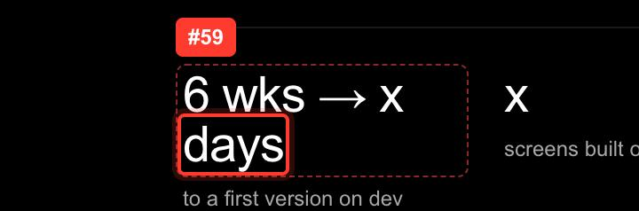

#### #185 · Heading: one word alone on the last line · Phone 375px · High

- **Where:** #impact ([open](http://localhost:3000/peetal#impact))
- **The problem line / text:** `days`
- **In the block:** "6 wks → x days"
- **Fix:** Smaller heading size on phones, or keep the last two words together (C).

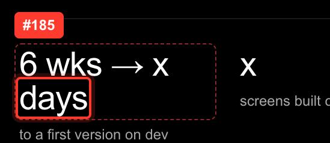

#### #180 · Widow: one word alone on the last line · Phone 375px · Medium

- **Where:** #tooling ([open](http://localhost:3000/peetal#tooling))
- **The problem line / text:** `nodes.`
- **In the block:** "Netra, a coded prototype of the purchase journey, is the UI/UX source of truth at handoff: 127 commits, every one co-authored with Claude, and 99 files that cite 167 Figma node IDs…"
- **Fix:** Use `text-wrap: pretty` on long paragraphs (B); keep the last two words together in short labels (D).

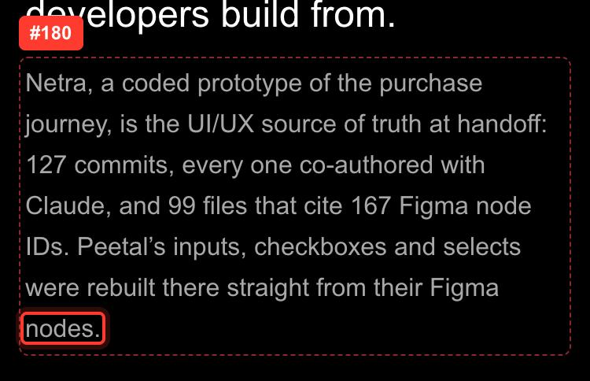

Low severity on this page (46), no screenshots

| # | Width | Where | Issue | Line as it breaks |
|---|---|---|---|---|
| 37 | Desktop | nav | Copy: straight apostrophe (use ’) | `What's` |
| 38 | Desktop | main | Copy: three dots instead of an ellipsis (…) | `PENDING...` |
| 39 | Desktop | main | Short word stranded at a line end | `One source of truth for` |
| 40 | Desktop | main | Short word stranded at a line end | `designers, developers and the` |
| 41 | Desktop | #context | Short word stranded at a line end | `Developers couldn’t keep up, and` |
| 42 | Desktop | #context | Short word stranded at a line end | `kits from Blade and UX4G exude whiffs of the` |
| 43 | Desktop | #principles | Short word stranded at a line end | `Code follows the documented spec, not the` |
| 44 | Desktop | #principles | Short word stranded at a line end | `Switching to Bangla, Devanagari or` |
| 45 | Desktop | #principles | Short word stranded at a line end | `as component props, so a person or an` |
| 46 | Desktop | #principles | Copy: straight apostrophe (use ’) | `can't` |
| 47 | Desktop | #principles | Short word stranded at a line end | `and semantic tokens are scoped to` |
| 48 | Desktop | #foundations | Short word stranded at a line end | `omponent tokens on top. The brand moved from` |
| 49 | Desktop | #foundations | Short word stranded at a line end | `ugh Web and Mobile modes: display runs 80 to` |
| 50 | Desktop | #code | Short word stranded at a line end | `rops mirror Figma properties one to one, and` |
| 51 | Desktop | #governance | Short word stranded at a line end | `llows one documentation template written for` |
| 52 | Desktop | #governance | Short word stranded at a line end | `Real masters, properties in` |
| 53 | Desktop | #governance | Short word stranded at a line end | `value bound to a token, a` |
| 54 | Desktop | #governance | Short word stranded at a line end | `Props mirror Figma one to` |
| 55 | Desktop | #governance | Short word stranded at a line end | `one, tokens only, a story for` |
| 56 | Desktop | #governance | Short word stranded at a line end | `every variant and state with` |
| 57 | Desktop | #governance | Short word stranded at a line end | `Figma node IDs cited in` |
| 58 | Desktop | #governance | Short word stranded at a line end | `few docs still describe sizes and states the` |
| 161 | Phone | main | Copy: three dots instead of an ellipsis (…) | `PENDING...` |
| 162 | Phone | main | Short word stranded at a line end | `One source of truth for` |
| 163 | Phone | #context | Short word stranded at a line end | `from Blade and UX4G exude whiffs of the` |
| 164 | Phone | #principles | Short word stranded at a line end | `Code follows the documented spec, not the` |
| 165 | Phone | #principles | Short word stranded at a line end | `Switching to Bangla, Devanagari or` |
| 166 | Phone | #principles | Short word stranded at a line end | `as component props, so a person or an` |
| 167 | Phone | #principles | Copy: straight apostrophe (use ’) | `can't` |
| 168 | Phone | #principles | Short word stranded at a line end | `and semantic tokens are scoped to` |
| 169 | Phone | #foundations | Short word stranded at a line end | `colours, and component tokens on top. The` |
| 170 | Phone | #foundations | Short word stranded at a line end | `Eight hues, each with a` |
| 171 | Phone | #foundations | Short word stranded at a line end | `The ramps were built in OKLCH with` |
| 172 | Phone | #foundations | Short word stranded at a line end | `UI method against the 7-step data and` |
| 173 | Phone | #foundations | Short word stranded at a line end | `Type runs on Anek across ten scripts, with` |
| 174 | Phone | #foundations | Short word stranded at a line end | `runs 80 to 48 on large screens and 48 to` |
| 175 | Phone | #components | Short word stranded at a line end | `structure and swaps only its tokens, so the` |
| 176 | Phone | #code | Short word stranded at a line end | `The Storybook pilot runs on React and` |
| 177 | Phone | #code | Short word stranded at a line end | `stories and 122 tokens pulled from the` |
| 178 | Phone | #code | Short word stranded at a line end | `to one, and comments cite the` |
| 179 | Phone | #tooling | Short word stranded at a line end | `127 commits, every one co-authored with` |
| 181 | Phone | #tooling | Short word stranded at a line end | `NetraBot studio grew out of the same work: a` |
| 182 | Phone | #governance | Short word stranded at a line end | `I oversee how Peetal is made and` |
| 183 | Phone | #governance | Short word stranded at a line end | `for engineers, with real values, such as a` |
| 184 | Phone | #governance | Short word stranded at a line end | `of it: a few docs still describe sizes and` |
| 186 | Phone | #next | Short word stranded at a line end | `The 16 intent boards for` |

### Logo lab

`/logo`

No high or medium incidents.

Low severity on this page (1), no screenshots

| # | Width | Where | Issue | Line as it breaks |
|---|---|---|---|---|
| 60 | Desktop | aside | Short word stranded at a line end | `▶ No material, just the white mark on` |

### Bima Saathi (gated)

`/bima-saathi`

#### #62 · Copy: em/en dash in visible text · Desktop 1440px · Medium

- **Where:** #details ([open](http://localhost:3000/bima-saathi#details))
- **The problem line / text:** `Oct – Dec 2024`
- **In the block:** "Oct – Dec 2024"
- **Fix:** Replace with " - ".

#### #190 · Copy: em/en dash in visible text · Phone 375px · Medium

- **Where:** #details ([open](http://localhost:3000/bima-saathi#details))
- **The problem line / text:** `Oct – Dec 2024`
- **In the block:** "Oct – Dec 2024"
- **Fix:** Replace with " - ".

Low severity on this page (13), no screenshots

| # | Width | Where | Issue | Line as it breaks |
|---|---|---|---|---|
| 61 | Desktop | #details | Short word stranded at a line end | ` insurance products beyond life, health, and` |
| 63 | Desktop | #overview | Short word stranded at a line end | `What if we put business insurance in the` |
| 64 | Desktop | #pain-points | Copy: straight apostrophe (use ’) | `didn't` |
| 187 | Phone | main | Short word stranded at a line end | `Designing the` |
| 188 | Phone | main | Short word stranded at a line end | `1,000 agents into` |
| 189 | Phone | #details | Short word stranded at a line end | `products beyond life, health, and` |
| 191 | Phone | #overview | Short word stranded at a line end | `insurance in the hands of the` |
| 192 | Phone | #overview | Short word stranded at a line end | `uote, slow to issue and hard to explain to a` |
| 193 | Phone | #overview | Short word stranded at a line end | `lient. That gap is where Saathi started. The` |
| 194 | Phone | #pain-points | Copy: straight apostrophe (use ’) | `didn't` |
| 195 | Phone | #research | Short word stranded at a line end | `intuitive, convenient, and` |
| 196 | Phone | #competitors | Short word stranded at a line end | `were complex and` |
| 197 | Phone | #process | Short word stranded at a line end | `What if we brought in` |

### BimaKavach Identity (gated)

`/bimakavach-identity`

#### #69 · Heading: one word alone on the last line · Desktop 1440px · High

- **Where:** #section-story-2 ([open](http://localhost:3000/bimakavach-identity#section-story-2))
- **The problem line / text:** `Platform.`
- **In the block:** "This helped in pivoting BimaKavach from a Recommendation Engine for urban startups to an SME Focused, Online Insure-Tech Brokerage Platform."
- **Fix:** Smaller heading size on phones, or keep the last two words together (C).

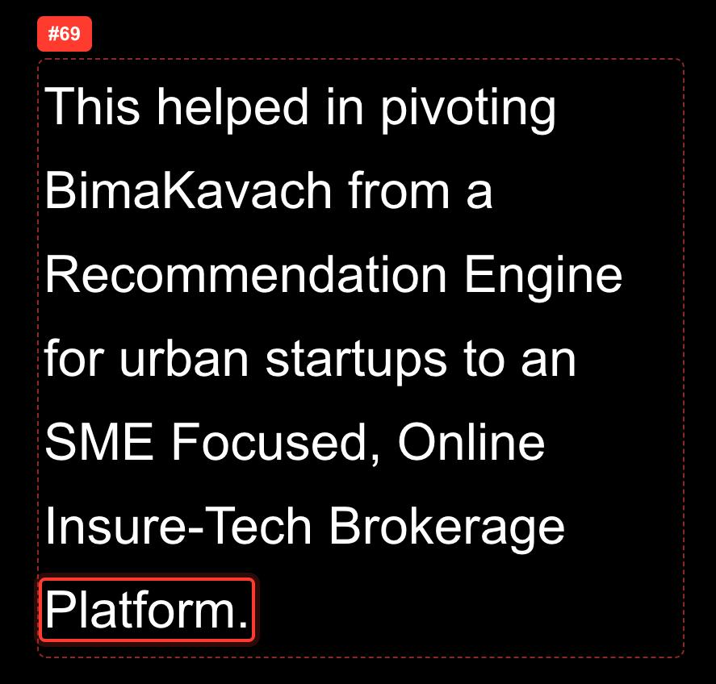

#### #67 · Widow: one word alone on the last line · Desktop 1440px · Medium

- **Where:** #section-story-0 ([open](http://localhost:3000/bimakavach-identity#section-story-0))
- **The problem line / text:** `Communication`
- **In the block:** "UX/UI Design, Visual Communication"
- **Fix:** Use `text-wrap: pretty` on long paragraphs (B); keep the last two words together in short labels (D).

#### #79 · Copy: grammar · Desktop 1440px · Medium

- **Where:** #section-story-4 ([open](http://localhost:3000/bimakavach-identity#section-story-4))
- **The problem line / text:** `Two Example of`
- **In the block:** "Two Example of Simplifying Forms:"
- **Fix:** “Two examples of simplifying forms:”

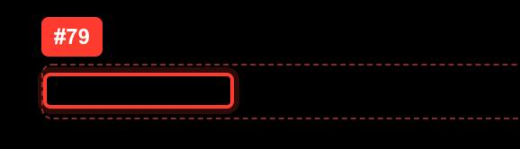

#### #80 · Copy: grammar · Desktop 1440px · Medium

- **Where:** #section-story-11 ([open](http://localhost:3000/bimakavach-identity#section-story-11))
- **The problem line / text:** `first movers advantage`
- **In the block:** "How do we capitalize on this first movers advantage?"
- **Fix:** “first-mover advantage”

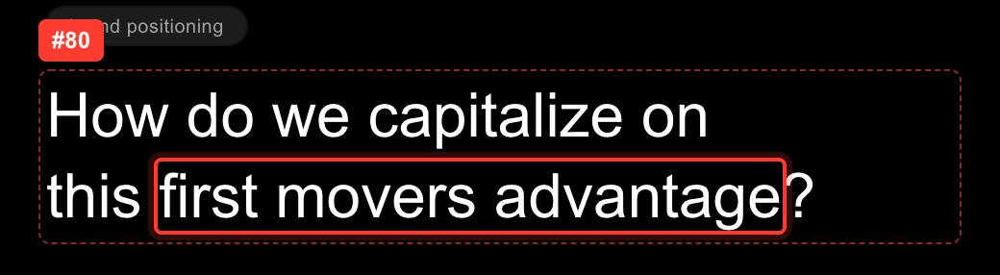

#### #81 · Copy: garbled phrase · Desktop 1440px · Medium

- **Where:** #section-work-1 ([open](http://localhost:3000/bimakavach-identity#section-work-1))
- **The problem line / text:** `my stint as at solving`
- **In the block:** "Through my stint as at solving for product, BimaKavach ended up realizing that the personality of the Brand was now feeling out of touch."
- **Fix:** e.g. “Through my stint solving for product”

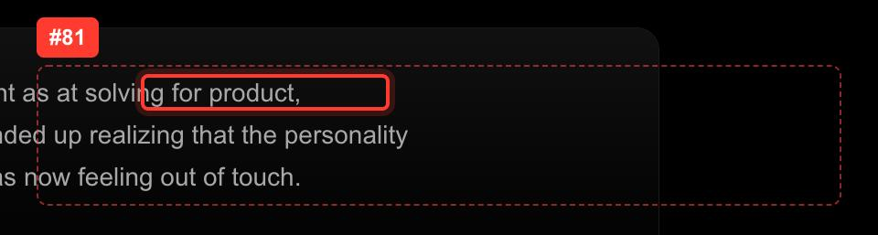

#### #82 · Copy: paragraph ends on a comma · Desktop 1440px · Medium

- **Where:** #section-work-1 ([open](http://localhost:3000/bimakavach-identity#section-work-1))
- **The problem line / text:** `insurance solutions,`
- **In the block:** "Experimenting with phases like using a 3D Mascot made before AI, having the “famous face” in Collaboration, beginning with having to move from a traditional brokerage house, and be…"
- **Fix:** end with a full stop

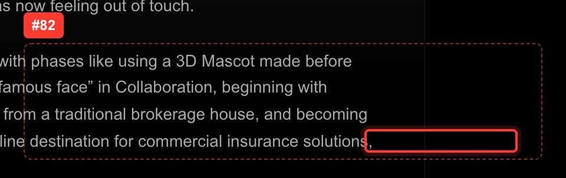

#### #83 · Copy: grammar · Desktop 1440px · Medium

- **Where:** #section-story-7 ([open](http://localhost:3000/bimakavach-identity#section-story-7))
- **The problem line / text:** `page exists and`
- **In the block:** "Massive diversions and permutations from the quote page exists and change per product - meaning that the journey must seem consistent and concise for any user"
- **Fix:** “permutations … exist”

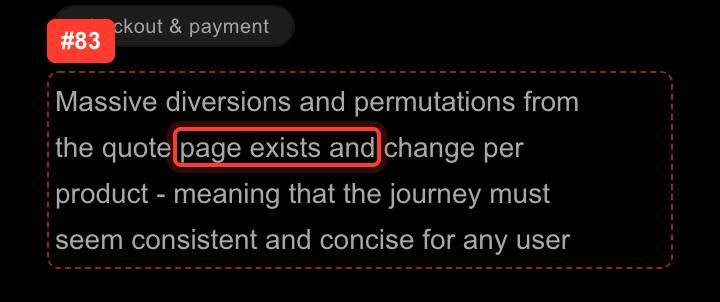

#### #84 · Copy: missing hyphen · Desktop 1440px · Medium

- **Where:** #section-story-5 ([open](http://localhost:3000/bimakavach-identity#section-story-5))
- **The problem line / text:** `asking no brainer`
- **In the block:** "By showcasing a loading state of the Quote Page and asking no brainer questions in the form of a modal - we were able to reduce drop-offs, as the user is now more incentivized to c…"
- **Fix:** “no-brainer”

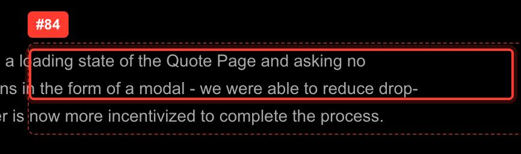

#### #199 · Widow: one word alone on the last line · Phone 375px · Medium

- **Where:** #hero ([open](http://localhost:3000/bimakavach-identity#hero))
- **The problem line / text:** `story`
- **In the block:** "TELL ME THE STORY"
- **Fix:** Use `text-wrap: pretty` on long paragraphs (B); keep the last two words together in short labels (D).

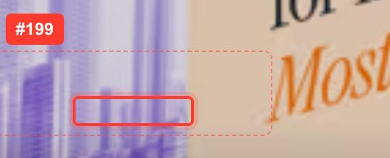

#### #201 · Widow: one word alone on the last line · Phone 375px · Medium

- **Where:** #hero ([open](http://localhost:3000/bimakavach-identity#hero))
- **The problem line / text:** `work`
- **In the block:** "SHOW ME THE WORK"
- **Fix:** Use `text-wrap: pretty` on long paragraphs (B); keep the last two words together in short labels (D).

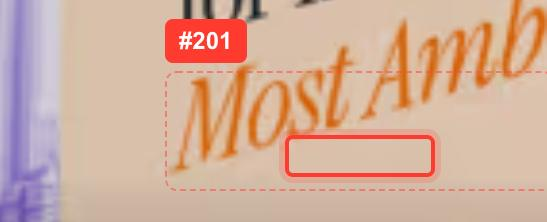

#### #205 · Widow: one word alone on the last line · Phone 375px · Medium

- **Where:** #section-story-0 ([open](http://localhost:3000/bimakavach-identity#section-story-0))
- **The problem line / text:** `Communication`
- **In the block:** "UX/UI Design, Visual Communication"
- **Fix:** Use `text-wrap: pretty` on long paragraphs (B); keep the last two words together in short labels (D).

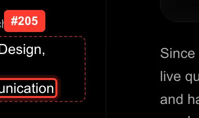

#### #207 · Widow: one word alone on the last line · Phone 375px · Medium

- **Where:** #section-story-3 ([open](http://localhost:3000/bimakavach-identity#section-story-3))
- **The problem line / text:** `time`
- **In the block:** "quote generation time"
- **Fix:** Use `text-wrap: pretty` on long paragraphs (B); keep the last two words together in short labels (D).

#### #211 · Widow: one word alone on the last line · Phone 375px · Medium

- **Where:** #section-work-1 ([open](http://localhost:3000/bimakavach-identity#section-work-1))
- **The problem line / text:** `solutions,`
- **In the block:** "Experimenting with phases like using a 3D Mascot made before AI, having the “famous face” in Collaboration, beginning with having to move from a traditional brokerage house, and be…"
- **Fix:** Use `text-wrap: pretty` on long paragraphs (B); keep the last two words together in short labels (D).

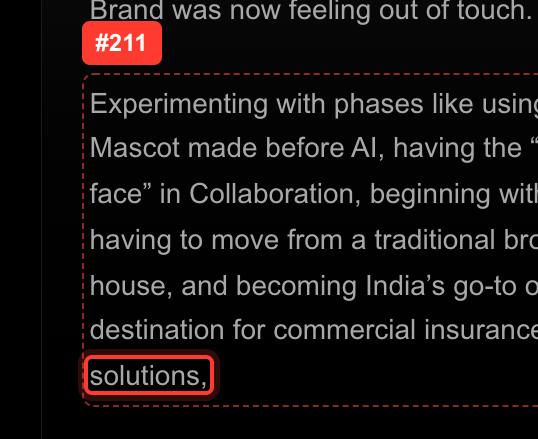

Low severity on this page (22), no screenshots

| # | Width | Where | Issue | Line as it breaks |
|---|---|---|---|---|
| 65 | Desktop | #hero | Short word stranded at a line end | `voting to the perception of BimaKavach as an` |
| 66 | Desktop | #section-story-0 | Short word stranded at a line end | `duct discovery, and has enabled payments for` |
| 68 | Desktop | #section-story-1 | Short word stranded at a line end | `r - and had to tackle challenges outside the` |
| 70 | Desktop | #section-story-2 | Short word stranded at a line end | `BimaKavach from a` |
| 71 | Desktop | #section-story-2 | Short word stranded at a line end | `for urban startups to an` |
| 72 | Desktop | #section-story-4 | Short word stranded at a line end | `ng Data to showcase the most used options as` |
| 73 | Desktop | #section-story-4 | Short word stranded at a line end | `ips - and allowing single select only if the` |
| 74 | Desktop | #section-story-5 | Hyphenated word wraps at its hyphen | `drop-offs,` |
| 75 | Desktop | #section-story-7 | Short word stranded at a line end | `Massive diversions and permutations from` |
| 76 | Desktop | #section-story-11 | Short word stranded at a line end | `How do we capitalize on` |
| 77 | Desktop | #section-story-11 | Short word stranded at a line end | `that users were likely to face challenges in` |
| 78 | Desktop | #section-work-1 | Short word stranded at a line end | `amous face” in Collaboration, beginning with` |
| 198 | Phone | #hero | Short word stranded at a line end | `Pivoting to the perception of` |
| 200 | Phone | #hero | Short word stranded at a line end | `Tell me the` |
| 202 | Phone | #hero | Short word stranded at a line end | `Show me the` |
| 203 | Phone | #section-story-0 | Hyphenated word wraps at its hyphen | `user-product` |
| 204 | Phone | #section-story-0 | Deep rag: a middle line far shorter | `Visual` |
| 206 | Phone | #section-story-3 | Short word stranded at a line end | `for Discovery &` |
| 208 | Phone | #section-story-4 | Short word stranded at a line end | `single select only if the user fits none of` |
| 209 | Phone | #section-story-5 | Short word stranded at a line end | `in the form of a modal - we were able to` |
| 210 | Phone | #section-story-10 | Short word stranded at a line end | `should the API fail in anticipation of or` |
| 212 | Phone | #section-work-3 | Short word stranded at a line end | `nterprise Software Offerings , BimaKavach is` |

## Not counted

- **Draft 006 title "Flows - Checkout / & Payment"**: the line break is set on purpose (from Figma).
- **BimaKavach Identity panels**: its horizontal layout puts panels off screen by design, so overflow checks are skipped there.

## How to refresh this

The audit is scripted: headless Chrome scrolls each page at both widths, measures where every line breaks, and captures each incident with the line boxed. Re-run it after fixes to get an updated copy of this file and its screenshots.
